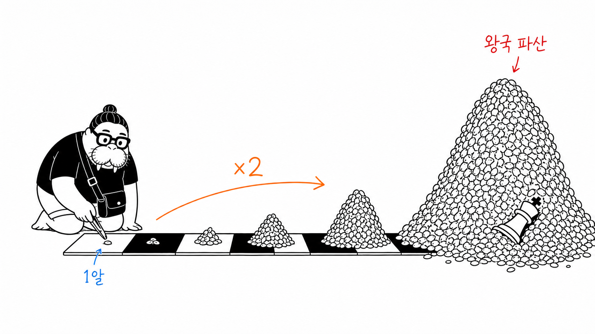
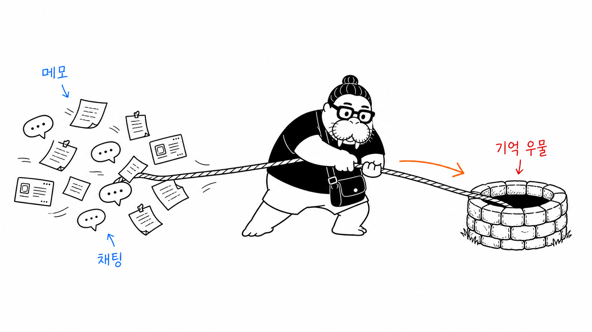

# Skills

Claude Code에서 쓰는 개인 스킬 모음. 각 폴더가 스킬 하나이며, `~/.claude/skills/`에 복사하면 바로 동작한다.

## 스킬 목록

| 스킬 | 설명 |
|---|---|
| [**kickoff**](./kickoff) | 프로젝트 시작 리추얼을 `/kickoff` 한 번으로 — 대화 기반 spec.md → MVP 단위 living plan.md → 디자인 브리프까지 3단계로 뽑아낸다. (원본: [Daekyo-Jeong/kickoff](https://github.com/Daekyo-Jeong/kickoff)) |
| [**dkdk-illustrations**](./dkdk-illustrations) | dkdk(바다코끼리 자화상 IP) 스타일의 한국어 본문 삽화 생성. 글을 소화해 shot list를 뽑고, 순백 배경 + 검정 손그림 + 소량의 빨강·주황·파랑 한글 주석 스타일로 장당 개별 생성한다. [ian-xiaohei-illustrations](https://github.com/helloianneo/ian-xiaohei-illustrations)를 dkdk IP + 한국어로 번안. |
| [**easel**](./easel) | 발산-선택-수렴 이미지 디자인 루프. 브리프에서 N장을 발산하고, 사람이 픽 + 코멘트하면 정체성을 유지하며 수렴한다. 마스코트·로고·일러스트를 반복해서 다듬을 때. 사람이 디렉터. (easel CLI 별도 필요) |
| [**handoff**](./handoff) | 현재 작업 세션의 전체 상태를 HANDOFF.md로 캡처해서, 다음 Claude(또는 사람)가 컨텍스트 손실 없이 이어받게 한다. |
| [**plain-writing**](./plain-writing) | 글을 쉬운 언어로, 사람이 쓴 것처럼(AI 티·번역투 없이) 쓰고 다듬는다. 보고서·이메일·공지·블로그 등 한국어 우선, 영어에도 적용. |

## dkdk-illustrations 예시

> "단순한 규칙 하나(×2)가 왕국을 삼키는 복잡성이 된다" — 체스판 밀알 전설



> "흩어진 메모·채팅을 하나의 기억 우물로 끌어모은다"



## 설치

```bash
git clone https://github.com/Daekyo-Jeong/Skills.git
cp -R Skills/<skill-name> ~/.claude/skills/
```

## 참고

- **dkdk-illustrations**는 이미지 생성 백엔드로 [easel](https://github.com/Daekyo-Jeong)(Codex 데스크탑 앱 + ocx 프록시, API 키 불필요)을 사용한다. 다른 환경에서는 `SKILL.md`의 생성 단계를 각자의 이미지 생성 도구로 교체하면 된다.
- 스킬 구조는 Claude Code의 [Agent Skills](https://code.claude.com/docs/en/skills) 규격(SKILL.md + references/)을 따른다.
