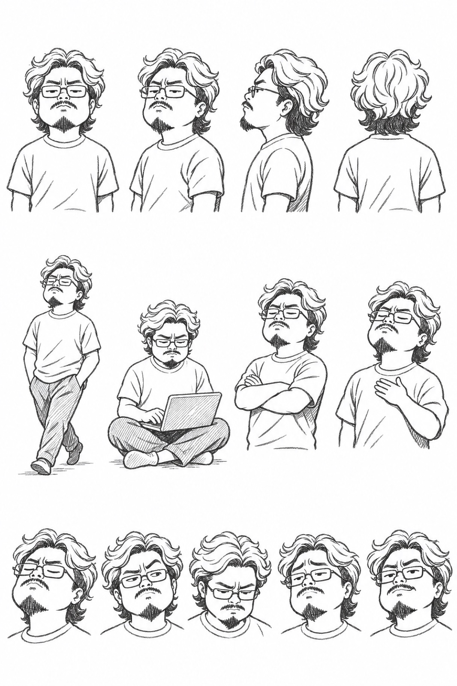
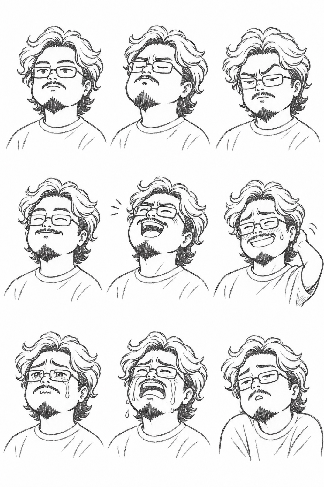

# dkdk-caricature

대교 본인을 흑연 연필 캐리커처로 그리는 Claude Code 스킬. 3:4 단독 컷, 상반신 + 소품 하나. 하단 한글 손글씨 캡션은 선택.

> 자매 스킬: `dkdk-walrus`(바다코끼리 수인화 본문 삽화), `didi`(픽셀 디디). 서로 대체하지 않는다.

## 기준 원화

시그니처: 웨이브 장발 · 얇은 사각 메탈 안경 · 팔자 콧수염 · 삼각 턱수염 · 무지 반팔티.

## 구성

- `SKILL.md` — 워크플로 (소재 → 생성 → QA → 저장)
- `references/character.md` — 캐릭터 스펙, 선 스타일, 표정·포즈, Do/Don't
- `references/caption.md` — 캡션 문형과 손글씨 규칙 (선택)
- `references/prompt-template.md` — 생성 프롬프트 (고정 아이덴티티 블록)
- `references/qa-checklist.md` — 검수
- `assets/reference-original.jpg` — 기준 원화 (생성 시 첫 번째 `-i`)
- `assets/model-sheet.jpg` — 모델시트: 턴어라운드 4 + 포즈 4 + 표정 5 (두 번째 `-i`)
- `assets/expression-sheet.jpg` — 표정 시트 3×3: 무표정·음미·판단 / 미소·폭소·멋쩍음 / 글썽·오열·체념 (세 번째 `-i`)
- `assets/examples/` — 테스트 1차 결과 3장(커피·코드 리뷰·영수증). 시각 캘리브레이션용, 구도 복제 금지

## 모델시트

## 생성 백엔드

easel (Codex CLI, ChatGPT 구독 로그인, API 키 불필요). dkdk-walrus와 같다.
