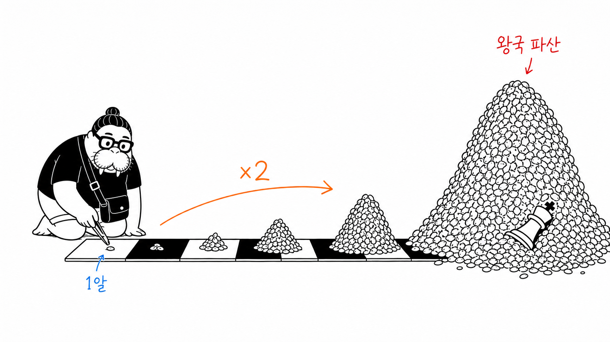
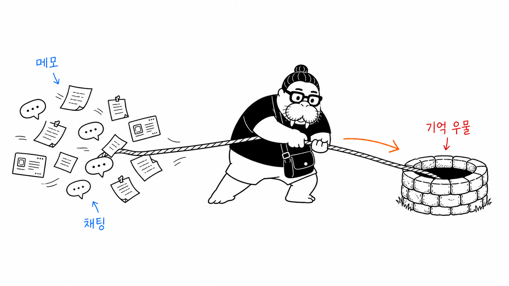
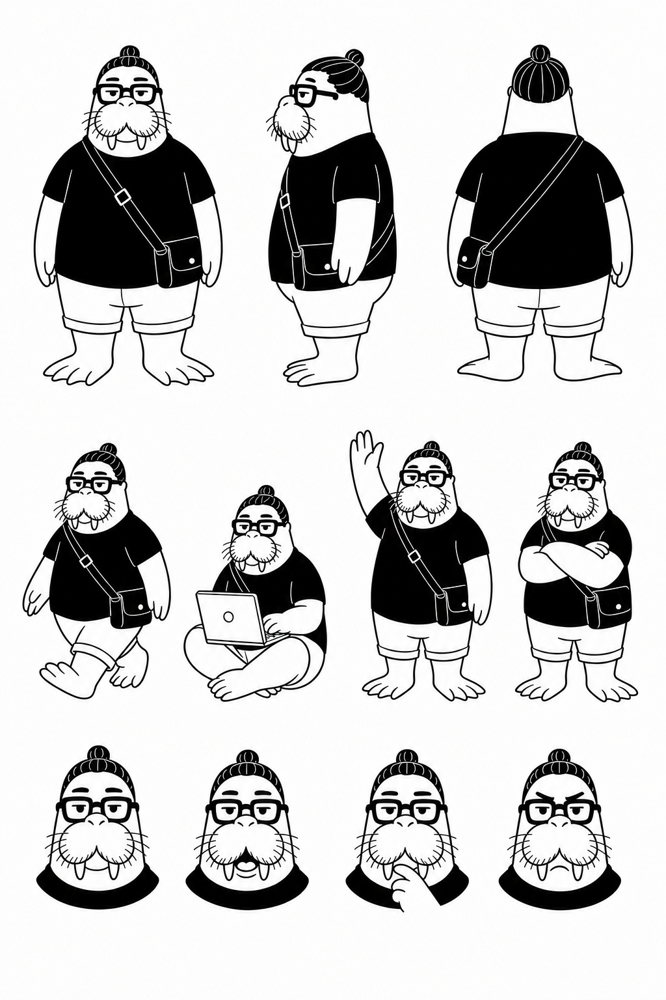

# dkdk-illustrations

dkdk(바다코끼리 자화상 IP) 스타일의 한국어 본문 삽화를 생성하는 Claude Code 스킬.

순백 배경 · 검정 손그림 선화 · 소량의 빨강(강조)/주황(흐름)/파랑(보조) 한글 손글씨 주석 · 16:9 가로. 글을 소화해 인지 앵커를 뽑고, 장당 하나의 은유를 새로 발명해서 그린다. [ian-xiaohei-illustrations](https://github.com/helloianneo/ian-xiaohei-illustrations)를 dkdk IP + 한국어로 번안했다.

## 예시

> "단순한 규칙 하나(×2)가 왕국을 삼키는 복잡성이 된다" — 체스판 밀알 전설

> "흩어진 메모·채팅을 하나의 기억 우물로 끌어모은다"

## 캐릭터

dkdk — 의인화 바다코끼리 자화상. 점눈, 뭉툭한 엄니 2개, 웰링턴 안경, 맨번, 다크 티셔츠(화면의 검은 앵커), 크로스백, 지느러미발. 아이덴티티 기준(생성 시 `-i`로 첨부): [`assets/dkdk-board-ink-bw.png`](assets/dkdk-board-ink-bw.png)

## 구성

- `SKILL.md` — 워크플로 (본문 소화 → shot list → 장당 생성 → QA → 저장)
- `references/style-dna.md` — 스타일 DNA와 금기
- `references/dkdk-ip.md` — 캐릭터 스펙·성격·동작 풀
- `references/composition-patterns.md` — 구조 유형 8종 + 은유 발명법
- `references/prompt-template.md` — 장당 생성 프롬프트 템플릿
- `references/qa-checklist.md` — 검수 체크리스트

## 생성 백엔드

기본은 easel CLI (Codex 데스크탑 앱 + ocx 프록시, API 키 불필요). 다른 환경에서는 `SKILL.md`의 생성 단계를 각자의 이미지 생성 도구로 바꾸면 된다 — 프롬프트 템플릿은 도구 무관.
