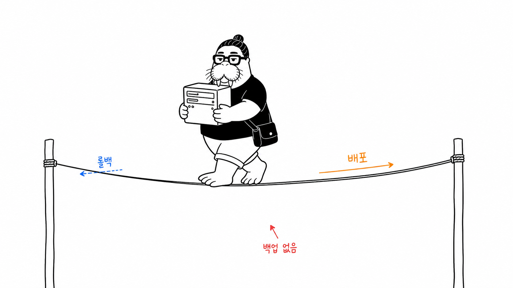
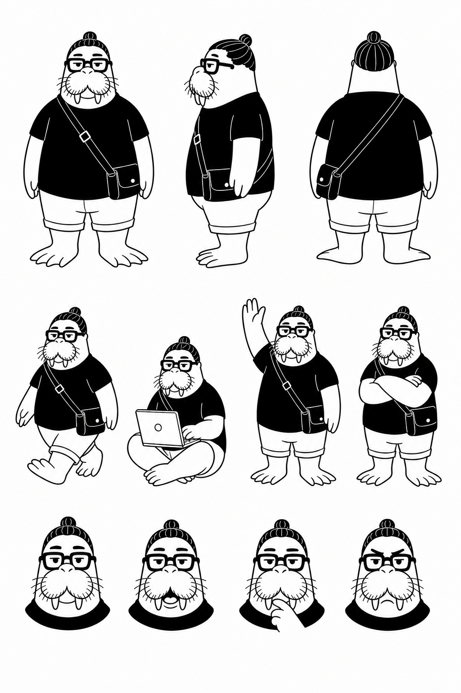
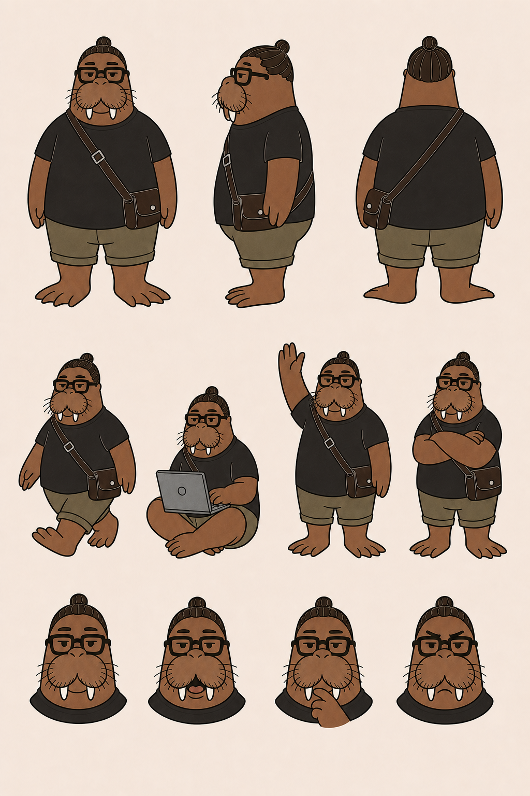
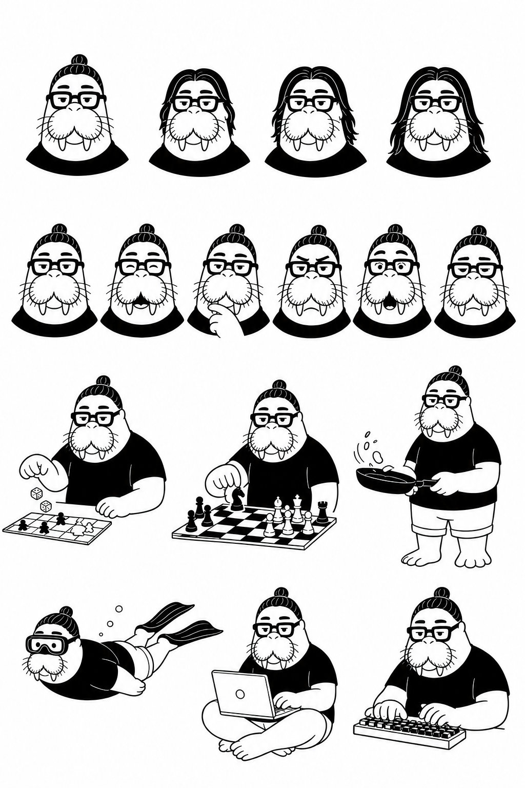
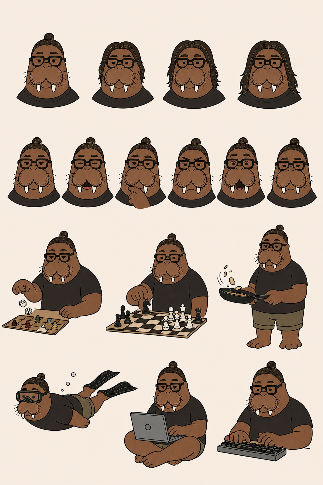

# dkdk-walrus

> 구 이름 `dkdk-illustrations` (2026-11-11 rename). 자매 스킬: `dkdk-caricature`, `didi`.

dkdk 수인화(바다코끼리 자화상 IP) 스타일의 한국어 본문 삽화를 생성하는 Claude Code 스킬.

순백 배경 · 검정 손그림 선화 · 소량의 빨강(강조)/주황(흐름)/파랑(보조) 한글 손글씨 주석 · 16:9 가로. 글을 소화해 인지 앵커를 뽑고, 장당 하나의 은유를 새로 발명해서 그린다. [ian-xiaohei-illustrations](https://github.com/helloianneo/ian-xiaohei-illustrations)를 dkdk IP + 한국어로 번안했다.

## 예시

> "백업 없는 배포는 외줄타기" — 주황 배포 방향, 파랑 롤백, 빨강이 가리키는 건 그물 없는 허공

## 캐릭터

dkdk — 의인화 바다코끼리 자화상. 가늘게 뜬 눈 + 각진 눈썹, 뭉툭한 엄니 2개, 웰링턴 안경, 맨번, 다크 티셔츠(화면의 검은 앵커), 크로스백, 지느러미발. 아이덴티티 기준(생성 시 `-i`로 첨부): [`assets/dkdk-board-ink-bw.png`](assets/dkdk-board-ink-bw.png)

**메인 모델시트** (잉크 / 컬러)

**버라이어티 보드** — 헤어 기장별 바리에이션 · 표정 · 활동(보드게임/체스/요리/프리다이빙/노트북/키보드), 크로스백 없는 버전 (잉크 / 컬러)

## 구성

- `SKILL.md` — 워크플로 (본문 소화 → shot list → 장당 생성 → QA → 저장)
- `references/style-dna.md` — 스타일 DNA와 금기
- `references/dkdk-ip.md` — 캐릭터 스펙·성격·동작 풀
- `references/composition-patterns.md` — 구조 유형 8종 + 은유 발명법
- `references/prompt-template.md` — 장당 생성 프롬프트 템플릿
- `references/qa-checklist.md` — 검수 체크리스트

## 생성 백엔드

기본은 easel CLI (Codex CLI, ChatGPT 구독 로그인, API 키 불필요). 다른 환경에서는 `SKILL.md`의 생성 단계를 각자의 이미지 생성 도구로 바꾸면 된다 — 프롬프트 템플릿은 도구 무관.
